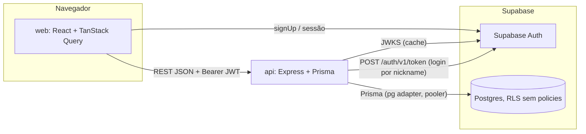
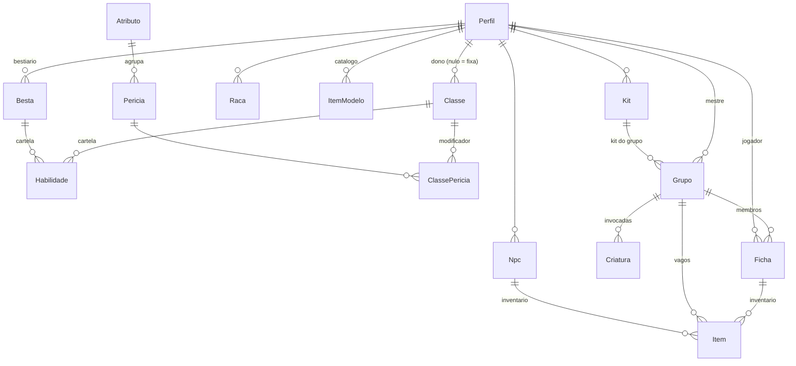

# One-Take: contexto do projeto

Fonte principal de contexto do One-Take. Descreve **o que o projeto é e como está hoje**; as instruções de como trabalhar nele
ficam em [`AGENTS.md`](AGENTS.md) e [`CLAUDE.md`](CLAUDE.md). Os detalhes ficam nos documentos de `docs/` (este arquivo resume e aponta):

| Assunto | Documento detalhado |
|---|---|
| Regras do jogo e do domínio | [`docs/DOMINIO.md`](docs/DOMINIO.md) |
| Pastas, fluxo de requisição, auth, env | [`docs/ARQUITETURA.md`](docs/ARQUITETURA.md) |
| Banco e relações | [`docs/DADOS.md`](docs/DADOS.md) |
| Rotas da API | [`docs/API.md`](docs/API.md) |
| Decisões datadas (histórico completo) | [`docs/DECISOES.md`](docs/DECISOES.md) |
| Pronto x próximo | [`docs/ROADMAP.md`](docs/ROADMAP.md) |
| Alterações por data | [`docs/CHANGELOG.md`](docs/CHANGELOG.md) |
| Como registrar decisões novas | [`docs/adr/README.md`](docs/adr/README.md) |

Última revisão: 2026-10-13, feita a partir do código do commit `a4482e2` e das alterações ainda não commitadas (rodapé e botões Login/Registrar-se do topo público).

---

## 1.1. Identificação

- **Nome:** One-Take.
- **Responsável:** Paulo Gomes (designer do produto; conta `@paulo` no app; repositório `github.com/paulotruly/One-Take`).
- **O que é:** sistema de RPG de mesa para **sessões únicas (one-shots)**: a história começa e termina no mesmo encontro.
  Como num hero shooter, o jogador **escolhe uma classe pronta**, com cartas de habilidade já definidas, em vez de montar um personagem do zero.
- **Problema que resolve:** a preparação de uma one-shot é longa (criar fichas, explicar regras). O app deixa o mestre montar o mundo
  antes (classes, raças, perícias, itens, criaturas, NPCs, kits) e dá aos jogadores fichas prontas, com testes já calculados.
  É um **RPG de mesa apoiado por tecnologia**: o app controla fichas e avisa; a mesa rola os dados, narra e aplica os efeitos.
- **Público-alvo (inferido da interface e dos textos):** mestres que conduzem one-shots e os jogadores dos seus grupos, em português.
  Não há documento formal de público-alvo.
- **Objetivo atual (CLAUDE.md):** interface do mestre (criar conteúdo e conduzir grupos), interface do jogador (fichas e inventário),
  login por nickname e regras públicas. **Ainda não existem:** sessões, rolagem de dados no app e combate guiado pelo app.

## 1.2. Estado atual

Classificação feita com evidência no código (rotas, telas e testes). "Teste" = há teste automatizado em `api/tests/`.

### Implementado
| Funcionalidade | Evidência |
|---|---|
| Cadastro (nome de usuário, data de nascimento e senha, pela API) e login por nome de usuário e senha (e-mail interno `<nick>@one-take.local` no Auth) | `api/src/modules/conta/`, `acesso.routes.ts`, `web/src/pages/LoginPage.tsx`, `CadastroPage.tsx`; teste |
| "Esqueceu a senha?" por código de recuperação (sem e-mail), exclusão da conta com senha e nome de usuário | `api/src/modules/conta/`, `api/src/lib/{codigo-recuperacao,supabase-auth,limite}.ts`, `web/src/pages/ContaPages.tsx`, `features/conta/`; teste (Supabase simulado) |
| Fichas arquivadas (cópia somente leitura quando a ficha sai do grupo) | `api/src/modules/fichas/{arquivo,retrato}.ts`, `web/src/features/fichas/pages/FichaArquivadaPage.tsx`; teste |
| Perfil (nickname, nome, foto por link); uma conta joga e pode ativar a interface de mestre | `modules/me/`, `web/src/pages/PerfilPage.tsx`, `AtivarMestrePage.tsx`; teste |
| Classes (fixas e do mestre), arquétipos/subclasses, duplicar, imagem por link | `modules/classes/`, `modules/conceitos/`, `web/src/features/classes/`; teste |
| Cartela de habilidades: tipos de efeito fixos, custo de mana, nível necessário, aprimoramentos, perícia do teste, status que ativa, reordenar | `modules/habilidades/`, `features/classes/pages/CartelaEditor.tsx`; teste |
| Catálogo de perícias por mestre (cópia das 18 base no 1º acesso), atributos fixos + do mestre | `modules/pericias/`, `modules/atributos/`, `prisma/pericias-base.ts`; teste |
| Raças com deslocamento, perícias de base e arquétipo de raça | `modules/racas/`, `features/racas/`; teste |
| Status (3 automáticos, 6 manuais fixos, próprios do mestre), aplicados em fichas, NPCs e criaturas | `modules/status/`, `regras/status.ts`, `prisma/status-base.ts`; teste |
| Grupos: código de entrada, limite, classes repetidas, o que vale no grupo, status ativos, regras padrão desligáveis e regras próprias | `modules/grupos/`, `regras/combate.ts`, `features/grupos/`; teste |
| Fichas: dados por atributo, recursos, perícias somadas, cartas do nível, subir nível, pontos de perícia, teste pronto | `modules/fichas/`, `regras/ficha.ts`, `regras/teste.ts`, `features/fichas/`; teste |
| Inventário e itens: catálogo do mestre, categorias fixas + próprias, espaços, usos, pré-requisito, passar, descartar, pegar | `modules/itens/`, `features/itens/`; teste |
| Bestiário (criaturas como classes), arquétipo de criatura, invocar no grupo, morte automática | `modules/bestas/`, `modules/criaturas/`, `features/bestiario/`; teste |
| NPCs com ficha (raça obrigatória, classe opcional, nível, dados, perícias, cartas, inventário, status) | `modules/npcs/`, `features/npcs/`; teste |
| Kits de RPG (coleções por aventura), kit ativo no navegador, kit do grupo | `modules/kits/`, `lib/kits.ts`, `features/kits/`; teste (API) |
| Documentação pública em `/docs` com busca por palavras; página inicial completa; Termos de uso e Política de privacidade (minutas) | `web/src/features/docs/`, `web/src/pages/HomePage.tsx`, `web/src/pages/LegalPages.tsx` (renderiza `docs/legal/*.md`) |
| Scripts de manutenção: promover conta, fixar classe, exportar conteúdo; skill de balanceamento | `api/scripts/`, `.claude/skills/balancear/` |
| Rodapé discreto em todas as páginas, com créditos, direitos e links legais | `web/src/components/layout/Rodape.tsx` |

### Parcialmente implementado
- **Teste de ação:** a ficha mostra o teste pronto ("2d20 + 5"), mas **o app não rola dados** nem desconta esforço (decisão: esforço manual).
- **Deploy:** há `web/vercel.json` (rewrite de SPA) e `npm run build`/`start` na API, mas o procedimento de deploy no Render e na Vercel
  **não está documentado** ("Em andamento" no ROADMAP). Não há `render.yaml` no repositório.
- **Progressão:** as regras existem, mas o próprio DOMINIO deixa em aberto se as cartas de um nível são todas recebidas ou escolhidas
  e se a perícia nova é escolhida ou pré-determinada (hoje: recebe todas; a perícia é escolhida na ficha).

### Planejado (ROADMAP, sem código)
- Sessões, rolagem de dados no app (com gasto de esforço), combate.
- Ideias em aberto: drag-and-drop de cartas, upload de imagem, testes de integração com Postgres real, testes de front,
  code-splitting, restaurar perícias base, recuperar senha sem email, desfazer pontos de perícia, desativar a interface de mestre,
  itens criados pelo jogador.

### Problemas conhecidos e limitações (fatos verificados)
- **Admin API não testada de verdade:** as chamadas ao Supabase (criar usuário, trocar senha, excluir) só foram testadas com respostas
  simuladas. Sem `SUPABASE_SECRET_KEY` o **cadastro fica indisponível** (503).
- **Sem limite de tentativas** próprio em `POST /api/entrar` (o Supabase Auth pode ter os dele; não verificado). Os limites novos (cadastro,
  links) são por IP em memória, por instância.
- **Lint do front:** `npm run lint` (oxlint) termina com 12 avisos e 0 erros (ex.: `set-state-in-effect` em `DocsLayout.tsx` e
  `BarraRecurso.tsx`, `only-export-components` em `AuthProvider.tsx`).
- **Bundle grande:** o build avisa sobre o tamanho do chunk (o ROADMAP cita cerca de 590 kB, puxados pelo `supabase-js`).
- **Sem testes no front** (só typecheck e build) e **sem testes de integração** com banco real (a API usa Prisma mockado).
- **Termos de uso e Política de privacidade são minutas** (`docs/legal/`), com campos pendentes visíveis no site; ver `docs/legal/REVISAO_LEGAL_PENDENCIAS.md`.
- **A home não tem capturas de tela** (não há imagens reais do app no repositório) nem planos (não há preços definidos).

### Pendências técnicas relevantes
Ver [1.12](#112-pendências-e-próximos-passos).

## 1.3. Stack tecnológica

Versões dos `package.json` (faixas `^`/`~`).

| Camada | Tecnologia | Função no projeto |
|---|---|---|
| Front | React 19, React DOM | Interface |
| Front | Vite 8 + `@vitejs/plugin-react` | Dev server e build |
| Front | TypeScript ~6.0 (`strict`) | Tipagem; `tsc -b` no build |
| Front | React Router 7 | Rotas (`web/src/router.tsx`) |
| Front | TanStack Query 5 | Cache, carregamento e invalidação dos dados da API (`features/*/api.ts`) |
| Front | lucide-react | **Único** conjunto de ícones permitido |
| Front | `@supabase/supabase-js` 2 | Cadastro (`signUp`) e sessão no navegador (`web/src/lib/supabase.ts`) |
| API | Node >= 22.12, TypeScript 7 (ESM `nodenext`) | Runtime e linguagem |
| API | Express 5 | HTTP; erros assíncronos chegam ao `error-handler` sem wrapper |
| API | Zod 4 (mensagens em pt) | Validação de corpo, query e env (`src/env.ts`, `*.schemas.ts`, `lib/validacao.ts`) |
| API | Prisma 7.10 + `@prisma/adapter-pg` + `pg` | ORM; client gerado em `api/src/generated/` (não versionado) |
| API | `jose` | Validação do JWT do Supabase via JWKS |
| API | `cors`, `dotenv` | CORS por lista de origens; leitura do `.env` |
| Banco | PostgreSQL no Supabase | Persistência; RLS ligado sem policies (só a API acessa) |
| Auth | Supabase Auth | Contas e sessões; papel fica na tabela `Perfil`, não no token |
| Testes | Vitest 5 + Supertest | Testes da API com Prisma mockado (`api/tests/prisma-falso.ts`) |
| Lint | oxlint | Lint do front (`npm run lint` em `web/`). A API não tem lint configurado |
| Dev | tsx | `npm run dev` da API e scripts |
| Hospedagem | Render (API), Vercel (web) | Declarado no CLAUDE.md; só a Vercel tem arquivo de config (`web/vercel.json`) |

**Integrações externas:** só o Supabase (Auth: JWKS e endpoint de token; Postgres). Imagens são **links externos** colados pelo
usuário e exibidos direto pelo navegador (sem upload; o Supabase Storage não é usado).

## 1.4. Arquitetura e estrutura

### Diretórios
```
api/                     API (independente: package.json, lockfile e .env próprios)
  prisma/                schema.prisma, migrations/ (23, de 20261011 a 20261013), seed.ts, pericias-base.ts, status-base.ts
  prisma.config.ts       CLI do Prisma usa DIRECT_URL
  scripts/               promover-mestre.ts, fixar-classe.ts, exportar-conteudo.ts
  src/index.ts, app.ts   ponto de entrada e montagem do Express
  src/env.ts             variáveis validadas com Zod
  src/lib/               prisma, errors (AppError), validacao, nickname, kits
  src/middleware/        auth (autenticar, exigirPapel), error-handler
  src/modules/<recurso>/ *.routes.ts -> *.service.ts -> *.schemas.ts
  src/regras/            regras de jogo puras: teste, progressao, ficha, status, combate
  tests/                 vitest + supertest
web/                     front (independente)
  src/main.tsx, router.tsx
  src/auth/              AuthProvider (sessão, useMe, interface lembrada), guards (RequirePapel)
  src/lib/               api.ts (fetch com JWT, ApiError), supabase.ts
  src/layouts/           PublicLayout, AppLayout (topo + barra lateral)
  src/components/        ui/ (Button, Field, Modal, ConfirmDialog, States, Avatar, Marca), texto/ (blocos da doc), layout/ (Rodape)
  src/features/<área>/   types.ts, api.ts (hooks), components/ (apresentação), pages/ (containers)
  src/pages/             Home, Login, Cadastro, Perfil, AtivarMestre, páginas simples (404)
  src/styles/            tokens.css (todo o visual), base.css, layout.css
docs/                    documentação técnica
.claude/skills/balancear skill de balanceamento (SKILL.md + calc.mjs)
```

### Visão geral


### Fluxo de uma requisição autenticada
```mermaid
sequenceDiagram
  participant F as Front (lib/api.ts)
  participant E as Express (app.ts)
  participant M as middleware/auth.ts
  participant R as modules/*/routes
  participant S as modules/*/service
  participant P as Prisma
  F->>E: /api/... Authorization: Bearer
  E->>M: autenticar (jwtVerify no JWKS; upsert do Perfil)
  M->>E: req.usuario
  E->>M: exigirPapel("MESTRE") nas rotas de gestão + garantirCatalogo
  E->>R: rota
  R->>R: schema.parse (Zod)
  R->>S: regras de acesso e de negócio
  S->>P: consultas
  S-->>F: JSON
  Note over E: erro lançado -> error-handler -> { error: { code, message, details? } }
```

### Pontos de entrada e montagem
- API: `api/src/index.ts` -> `criarApp` em `api/src/app.ts`. Ordem: `cors` -> `express.json` (100 kb) -> `/health` ->
  `/api` público (`regrasRouter`, `acessoRouter`) -> `autenticar` -> `meRouter`, `fichasRouter` (qualquer conta) ->
  `exigirPapel("MESTRE")` + `garantirCatalogo` -> routers de gestão -> 404 -> `errorHandler`.
- Web: `web/src/main.tsx` (providers) e `web/src/router.tsx` (rotas). As rotas estão listadas em `docs/ARQUITETURA.md` (seção Web).
- Endpoints: lista completa em `docs/API.md`. Grupos de rotas: público (`/api/regras`, `/api/entrar`, `/api/nicknames/:n`),
  conta (`/api/me`), jogador e mestre (`/api/fichas`, `/api/convites`, `/api/itens`) e gestão do mestre (classes, habilidades,
  perícias, atributos, raças, conceitos, status, grupos, regras da mesa, bestas, criaturas, catálogo e categorias de item, NPCs, kits).

### Comunicação entre módulos
- Routers só fazem HTTP e o parse com Zod; services têm as regras e o Prisma.
- Regras de jogo numéricas ficam em `api/src/regras/` (funções puras) e são usadas pelos services. O front não recalcula: lê da API
  (inclusive os números da documentação pública, via `GET /api/regras` e `useRegras()`).
- Acesso a classes: `classeLegivel` e `classeEditavel` em `classes.service.ts`; recursos filhos reutilizam.
- Soma de perícias: `api/src/modules/pericias/soma.ts` (`somarPericias`, `testeDaCarta`), usada por ficha, NPC e pré-requisito de item.
- Kits: `api/src/lib/kits.ts` (`kitIdsSchema`, `validarKits`, `definirKits`, `visivelNoKit`).

### Modelo de dados (resumo)
Fonte da verdade: `api/prisma/schema.prisma`; explicação completa em `docs/DADOS.md`.

Padrões do modelo: "fixo do sistema" = `donoId` nulo (classes, perícias base, atributos, status, categorias de item); a ficha guarda
só o que muda (máximos são calculados); item lançado é cópia do molde; RLS ligado sem policies; UUID em tudo.

## 1.5. Regras de negócio

Regras de jogo detalhadas em `docs/DOMINIO.md`. Os números (3 pontos de atributo, 5 espaços, +5 por nível etc.) vêm de
`api/src/regras/` e são expostos em `GET /api/regras`. Caminhos abaixo relativos a `api/` salvo indicação.

| ID | Regra | Comportamento e restrições | Onde | Testes |
|---|---|---|---|---|
| RN-001 | Teste com d20 | 1 d20 por ponto no atributo, vale o maior, soma o bônus da perícia (sem a perícia, 0). Sucesso se total >= DT | `src/regras/teste.ts` | `tests/teste.test.ts` |
| RN-002 | Atributo com 0 pontos | Sempre 1 d20; o resultado vale a metade, arredondada para baixo, antes do bônus | `src/regras/teste.ts` | `tests/teste.test.ts` |
| RN-003 | Esforço = dados extras | 1 ponto de esforço = +1 d20; com atributo 0 não compra dados; sem limite por teste. O app não desconta esforço | `src/regras/teste.ts` | `tests/teste.test.ts` |
| RN-004 | DT livre | O mestre define a DT na sessão; não há tabela oficial (a doc mostra só as chances) | só documentação (`regras/teste.ts` calcula as chances) | `tests/teste.test.ts` (chances) |
| RN-005 | Valores base nunca zero | Classe, criatura e NPC sem classe: vida, mana e esforço base >= 1 (Zod + CHECK no banco) | `classes.schemas.ts`, `bestas.schemas.ts`, `npcs.schemas.ts`, migrations | `tests/api.test.ts`, `tests/bestiario.test.ts` |
| RN-006 | Conteúdo fixo é somente leitura | Classe fixa (403 `CLASSE_FIXA`), atributo fixo (`ATRIBUTO_FIXO`), status fixo (`STATUS_FIXO`), categoria fixa (`CATEGORIA_FIXA`) | `classes.service.ts`, `atributos.service.ts`, `status.service.ts`, `itens/categorias.ts` | `api.test.ts`, `status.test.ts`, `bestiario.test.ts` |
| RN-007 | Conteúdo de outro mestre é invisível | Responde 404 (não 403), para não revelar que existe | `classeLegivel` e equivalentes nos services | `api.test.ts`, `grupos.test.ts`, `bestiario.test.ts` |
| RN-008 | Progressão de nível | Por nível acima do 1: +5 vida, +5 mana, +5 esforço, +5 pontos de perícia, +2 espaços; nível N libera as cartas com nível necessário <= N | `src/regras/progressao.ts`, `src/regras/ficha.ts` | `tests/progressao.test.ts`, `grupos.test.ts` |
| RN-009 | Subir de nível | Só o mestre sobe; +5 também nos atuais; máximo 100 (409 `NIVEL_MAXIMO`); descer de nível não existe para personagens de jogadores (NPC pode mudar o nível livremente) | `fichas.service.ts`, `npcs.service.ts` | `grupos.test.ts`, `correcoes.test.ts` |
| RN-010 | Entrada no grupo | 1 ficha por jogador por grupo (`JA_TEM_FICHA`); o mestre não cria ficha no próprio grupo; grupo cheio (`GRUPO_CHEIO`); sem classes repetidas quando o grupo não permite (`CLASSE_REPETIDA`); classe e raça precisam estar liberadas | `fichas.service.ts` | `grupos.test.ts` |
| RN-011 | Pontos de atributo | Soma exata de 3 entre os atributos do grupo; um atributo pode ficar com 0 | `src/regras/ficha.ts`, `fichas.service.ts` | `grupos.test.ts` |
| RN-012 | Recursos atuais | Sempre entre 0 e o máximo; o jogador só **diminui** a vida (aumentar = 403 `SO_MESTRE_CURA`); mana e esforço nos dois sentidos | `fichas.service.ts` | `grupos.test.ts`, `correcoes.test.ts` |
| RN-013 | Morte e cansaço | Vida 0 ou mana 0 = morto; esforço 0 = Cansado (status automáticos, calculados, não gravados) | `src/regras/status.ts` | `tests/status.test.ts` |
| RN-014 | Criatura morre sozinha | Vida ou mana em 0 apaga a criatura invocada; nomes numerados continuam do maior número | `modules/criaturas/criaturas.service.ts` | `bestiario.test.ts`, `correcoes.test.ts` |
| RN-015 | Inventário por espaços | 5 espaços no nível 1, +2 por nível; soma `espacos` dos itens (409 `INVENTARIO_CHEIO`) | `src/regras/ficha.ts`, `itens.service.ts` | `grupos.test.ts` |
| RN-016 | Pré-requisito de item | Classe igual e/ou perícia com total > 0 são conferidos; texto é informativo; quem não cumpre carrega mas não usa (403 `NAO_SABE_USAR`); o mestre usa por qualquer um | `motivoParaNaoUsar` em `src/regras/ficha.ts` | `bestiario.test.ts` |
| RN-017 | Uso e consumo de item | Usar gasta 1 uso; no último o item é apagado; item vago não é usado | `itens.service.ts` | `bestiario.test.ts` |
| RN-018 | Item lançado é cópia | Editar ou excluir o molde do catálogo não muda itens já lançados | `itens/catalogo.routes.ts` | `bestiario.test.ts` |
| RN-019 | Movimentação de itens | Jogador: passa para outra ficha do grupo, descarta (fica vago) ou pega vago; mestre move qualquer um (inclusive de/para NPC); item com NPC não pertence a grupo | `itens.service.ts` | `grupos.test.ts`, `bestiario.test.ts`, `correcoes.test.ts` |
| RN-020 | Status aplicados | Só o mestre aplica; só status ativados no grupo e não automáticos (fichas e criaturas); NPC usa todos os do mestre; status do mestre é sempre manual | `status.service.ts`, `fichas.service.ts` | `status.test.ts` |
| RN-021 | NPC | Raça obrigatória; sem classe exige vida/mana/esforço base; com classe usa a base da classe no nível; mudar nível/classe/base faz o atual acompanhar | `npcs.service.ts`, `npcs.schemas.ts` | `bestiario.test.ts` |
| RN-022 | Catálogo de perícias por mestre | No 1º acesso à área de mestre, as 18 perícias base são copiadas para ele uma única vez (`catalogoIniciado`) | `garantirCatalogo` em `pericias.service.ts` | `api.test.ts` |
| RN-023 | Atributos | Nome único (inclusive contra os fixos, 409 `NOME_EM_USO`); com perícias não exclui (409 `ATRIBUTO_EM_USO`) | `atributos.service.ts` | `api.test.ts` |
| RN-024 | Exclusão bloqueada por uso | Excluir algo referenciado por fichas/NPCs com FK `RESTRICT` responde 409 `EM_USO` | `src/middleware/error-handler.ts` (P2003) | não identificado |
| RN-025 | Aprimoramento de carta | Nível maior que o da carta, pelo menos uma mudança, um por nível (`NIVEL_EM_USO`); acumulam; o nível necessário da carta não pode alcançar um aprimoramento | `aplicarAprimoramentos` em `src/regras/progressao.ts`, `habilidades.service.ts` | `progressao.test.ts`, `api.test.ts`, `correcoes.test.ts` |
| RN-026 | O que vale no grupo | Só conteúdo do mestre (ou fixo); perícias marcadas precisam estar dentro dos atributos marcados; limite de membros não fica abaixo dos atuais | `grupos.service.ts` | `grupos.test.ts` |
| RN-027 | Regras padrão de combate | Valem por padrão; o mestre desliga por grupo (só slugs conhecidos) e cria regras próprias | `src/regras/combate.ts`, `grupos.routes.ts` | `progressao.test.ts`, `grupos.test.ts` |
| RN-028 | Kits de RPG | `kitIds` só com kits do próprio mestre (404); mandar `kitIds` troca a lista inteira; sem kit = geral; excluir kit não apaga conteúdo | `src/lib/kits.ts`, `modules/kits/kits.routes.ts` | `correcoes.test.ts` |
| RN-029 | Filtro por kit | Grupo com kit: do kit + gerais (`visivelNoKit`, API e web). Kit ativo nas telas do mestre: **só o kit**, mais o que é fixo do sistema (`soDoKit`, só no web) | `api/src/lib/kits.ts`, `web/src/features/kits/types.ts` | API: `correcoes.test.ts`; web: sem testes |
| RN-030 | Conta e acesso | Toda conta joga; a interface de mestre é ativada no cadastro ou depois (`POST /api/me/mestre`); rotas de gestão exigem papel MESTRE (403) | `src/app.ts`, `middleware/auth.ts`, `modules/me/` | `api.test.ts`, `bestiario.test.ts` |
| RN-032 | Código de recuperação | 100 bits aleatórios, mostrado uma vez, guardado como SHA-256, trocado a cada uso; mesma resposta para usuário inexistente ou código errado; 10 tentativas por hora por IP | `lib/codigo-recuperacao.ts`, `conta.service.ts` | `tests/conta.test.ts` |
| RN-034 | Troca de senha | Com o código: troca pela Admin API e as sessões anteriores são recusadas pela API | `conta.service.ts`, `middleware/auth.ts` | `tests/conta.test.ts` |
| RN-035 | Exclusão da conta | Senha + o próprio nome de usuário digitado; exclusão imediata, idempotente e retomável; conta em exclusão não usa a API | `excluirConta` em `conta.service.ts`, `scripts/concluir-exclusoes.ts` | `tests/conta.test.ts` |
| RN-036 | Fichas arquivadas | Sair, ser removido, grupo excluído ou mestre que exclui a conta: o jogador fica com a cópia (só ele vê e apaga) | `modules/fichas/{arquivo,retrato}.ts` | `tests/conta.test.ts` |
| RN-037 | Idade mínima | 12 anos completos, pela data de nascimento do cadastro, conferida com a data do servidor (400 em `dataNascimento`) | `src/regras/conta.ts`, `conta.schemas.ts` | `tests/conta-regras.test.ts`, `tests/conta.test.ts` |
| RN-038 | Exportação de dados | O titular baixa um JSON com tudo o que é dele, sem dados de outras pessoas nem dados internos | `exportarDados` em `conta.service.ts` | `tests/conta.test.ts` |
| RN-031 | Login e nickname | Login por nickname (ou email antigo); senha errada = 401 genérico; nickname 3–20 `[a-z0-9_.-]`, único (409 `NICKNAME_EM_USO`) | `modules/acesso/acesso.routes.ts`, `src/lib/nickname.ts`, `me.schemas.ts` | `api.test.ts` |

### Pendências de confirmação (regras ambíguas)
- Cartas de um nível: todas recebidas (comportamento atual) ou escolhidas? Perícia nova: escolhida (atual) ou pré-determinada? (DOMINIO, ROADMAP)
- Status fixos manuais (Assustado, Furioso, Inspirado, Confiante, Envenenado, Atordoado) estão marcados como "proposta inicial" em `prisma/status-base.ts`.
- Referências de equilíbrio da skill `balancear` são proposta inicial, ajustáveis pelo designer.
- O grupo com kit mostra "do kit + gerais", enquanto o kit ativo mostra "só o kit": a diferença foi uma interpretação registrada em
  DECISOES (2026-10-13) e ainda não foi confirmada pelo responsável.

## 1.6. Padrões e convenções

### Encontrados no código
- **Idioma:** código e domínio em português (`Classe`, `Habilidade`, `Pericia`), termos técnicos em inglês quando idiomáticos.
  Nomes antigos mantidos no banco e nas rotas apesar da troca de rótulo na interface: `ClasseConceito`/`/api/conceitos` = Arquétipo;
  `Besta` = criatura do bestiário; `Criatura` = criatura invocada.
- **API por módulo:** `api/src/modules/<recurso>/{*.routes,*.service,*.schemas}.ts`. Imports relativos com `.js` (ESM `nodenext`).
- **Erros:** sempre lançar `AppError` (helpers em `api/src/lib/errors.ts`: `naoEncontrado`, `proibido`, `conflito`, `requisicaoInvalida`...);
  o `error-handler` formata `{ error: { code, message, details? } }`. Nunca responder erro manualmente.
- **Validação:** Zod 4 nas rotas; mensagens em português; schemas de PATCH = `base.partial()` de um objeto **sem defaults**
  (no Zod 4, `default()` em campo opcional seria aplicado num PATCH parcial). Texto opcional `""` vira `null`.
- **Regras de jogo:** funções puras em `api/src/regras/`, com testes; o front só exibe o que a API calcula.
- **Schema do banco:** editar `schema.prisma` -> `npm run db:migrate -- --name <nome>` -> atualizar `docs/DADOS.md`. Nunca editar
  uma migration já aplicada (o checksum em `_prisma_migrations` quebra).
- **Front:** `features/<área>/types.ts` (tipos espelhando a API), `api.ts` (hooks TanStack Query; cada mutação invalida as chaves
  afetadas), `components/` (apresentação, só props) e `pages/` (dados, modais, navegação). Formulários controlados com `useState`,
  sem biblioteca; erros da API aparecem por campo (`errosDeCampo`, `erroDeFormulario` em `web/src/lib/api.ts`).
- **Estado local no navegador:** só conveniências (interface lembrada em `auth/AuthProvider.tsx`, kit ativo em `features/kits/types.ts`),
  sempre com `try/catch`.
- **Estilo:** só variáveis de `web/src/styles/tokens.css`; CSS por área (`styles/layout.css`, `features/*/components/*.css`).
- **Testes:** Vitest + Supertest com Prisma mockado. Cada modelo usado precisa estar listado em `api/tests/prisma-falso.ts`.
  Hoje são 7 arquivos e 122 testes.

### Recomendações (ainda não adotadas)
- Lint também na API (só o front tem oxlint).
- Testes de componentes no front e testes de integração com Postgres real (ROADMAP).
- Resolver os 12 avisos do oxlint.

## 1.7. Segurança e privacidade

| Tema | O que existe | Pendências |
|---|---|---|
| Autenticação | Supabase Auth; a API valida o JWT via JWKS (`jose`), com issuer `${SUPABASE_URL}/auth/v1` e audience `authenticated` (`middleware/auth.ts`). Exige *JWT Signing Keys* assimétricas. Recuperação de senha por código de recuperação (sem e-mail); sessões anteriores à troca são recusadas (claim `amr`) | Validar o claim `amr` com tokens reais |
| Autorização | Papel na tabela `Perfil` (não no token); `exigirPapel("MESTRE")` nas rotas de gestão; posse verificada nos services (outro dono = 404); ações só do mestre do grupo (subir nível, aplicar status, curar) | Não há papel de administrador; mudar papel é por script (`npm run promover`) |
| Rotas no front | `RequirePapel` (`web/src/auth/guards.tsx`); 401 da API faz `signOut` | A proteção real é a da API |
| Entradas | Zod em corpo e query; `express.json` com limite de 100 kb; ids malformados = 404; links de imagem validados como http(s) | Sem limite de tentativas em `POST /api/entrar` |
| Banco | RLS ligado **sem policies** em todas as tabelas: a Data API do Supabase não expõe nada com a chave pública; só a API (papel `postgres`) acessa | |
| Segredos | `.env` fora do git (`.gitignore`); `.env.example` sem valores. API: `DATABASE_URL`, `DIRECT_URL`, `SUPABASE_URL`, `SUPABASE_PUBLISHABLE_KEY`, `SUPABASE_SECRET_KEY`, `TRUST_PROXY`, `CORS_ORIGIN`, `PORT`. Web: `VITE_SUPABASE_URL`, `VITE_SUPABASE_PUBLISHABLE_KEY`, `VITE_API_URL`. A chave secreta do Supabase fica **só na API** | |
| Dados pessoais | Guardados: nome de usuário, nome opcional, link de foto, data de nascimento, hash do código de recuperação, e-mail técnico interno do login (`@one-take.local`; real só em contas muito antigas criadas no painel) e o conteúdo das fichas. Nenhum e-mail de contato. O email **nunca é exposto** pela API (`/api/me` e login por nickname). Política em `/privacidade` | Política em versão inicial, a revisar |
| Logs | Erros inesperados vão para `console.error(err)` no `error-handler`; o cliente recebe só `ERRO_INTERNO` | O objeto de erro completo pode conter dados da requisição; avaliar o que é logado em produção |
| Exclusão e retenção | Exclusão da conta pelo próprio usuário (senha + nome de usuário, imediata); fichas que saem de grupos viram cópias arquivadas do jogador; detalhes na política (`docs/legal/`) | Supabase gratuito sem backups automáticos |
| CORS | Lista de origens em `CORS_ORIGIN` | |
| Integrações | Só Supabase. Imagens externas são carregadas pelo navegador a partir do link do usuário | Links externos podem apontar para qualquer host |

## 1.8. Interface e experiência do usuário

- **Regras obrigatórias (CLAUDE.md):** sem emojis em código, interface, comentários e logs; nenhum caractere usado como ícone
  (setas, estrelas): ícones **só do `lucide-react`**; **tema claro com fundo branco**, interface simples; **cantos retos**
  (`--raio-*` = 0). Não há tema escuro.
- **Identidade:** marca "One-Take" com o ícone `Dices` (`components/ui/Marca.tsx`, provisória segundo DECISOES); cor primária índigo
  (`--cor-primaria: #4f46e5`); cores próprias para vida, mana, esforço, grupos de classe e origem (fixa x própria).
- **Tokens (`web/src/styles/tokens.css`):** cores, tipografia (`system-ui`, tamanhos `--texto-xs` a `--texto-xl`), espaçamentos
  `--esp-1` a `--esp-7`, larguras e transições. Componentes não usam valores literais.
- **Componentes reutilizáveis:** `components/ui/` (Button com variantes e tamanho pequeno, Field com rótulo, dica e erro, Modal
  com `<dialog>` nativo, ConfirmDialog, Loading, EmptyState, ErrorState, Avatar, Marca), `components/texto/` (Destaque, Passos,
  Cartoes, Tabela, para a documentação), `components/layout/Rodape.tsx`.
- **Layouts e navegação:** `PublicLayout` (links no topo e os botões Login e Registrar-se, sempre visíveis; com sessão aberta eles levam à área da conta) e `AppLayout` (topo com marca, troca Mestrar/Jogar,
  menu do perfil com Editar perfil e Sair; **barra lateral** com os links da interface e o seletor de kit ativo, que no celular vira
  gaveta). Rodapé discreto nos dois.
- **Estados:** carregando, vazio e erro com `Loading`/`EmptyState`/`ErrorState` (com "tentar novamente"); confirmações destrutivas
  com `ConfirmDialog`; erros de validação embaixo de cada campo.
- **Responsivo:** quebra principal em 760px (gaveta lateral, rodapé em coluna); fichas e inventário pensados para celular
  (linhas grandes e tocáveis, ações num pop-up).
- **Acessibilidade encontrada:** `aria-label` em botões só com ícone, `aria-current` na navegação, `role="status"` em avisos,
  ícones decorativos com `aria-hidden`, reordenação de cartas por botões (sem arrastar). Não houve auditoria formal de acessibilidade.

## 1.9. Execução e manutenção

**Pré-requisitos:** Node >= 22.12 (engines da API), npm, um projeto Supabase (passo a passo em `docs/ARQUITETURA.md`, seção
"Configuração do Supabase", incluindo desligar "Confirm email").

```bash
npm run install:all          # na raiz: instala api/ e web/ (o postinstall da API roda prisma generate)
cp api/.env.example api/.env # e web/.env.example -> web/.env; preencher sem versionar

# API (em api/)
npm run dev                  # porta 3333, com reload (tsx watch)
npm run db:migrate           # cria/aplica migration em dev (usa DIRECT_URL)
npm run db:deploy            # aplica migrations pendentes (produção ou banco compartilhado)
npm run db:seed              # estrutura fixa: atributos, status, categorias, perícias base (idempotente; não cria classes)
npm run db:studio            # Prisma Studio
npm run promover -- email    # muda o papel de uma conta (padrão MESTRE)
npm run fixar-classe -- "Título"   # classe de um mestre vira fixa; --devolver nick desfaz
npm run exportar -- > ../conteudo.json   # JSON para a skill de balanceamento (arquivo no .gitignore)
npm test                     # vitest
npm run typecheck
npm run build                # prisma generate + tsc; npm start roda dist/src/index.js

# Web (em web/)
npm run dev                  # http://localhost:5173
npm run lint                 # oxlint
npm run build                # tsc -b + vite build
npm run preview

# Atalhos na raiz
npm run dev:api | dev:web | test | build
```

**Deploy (identificado, não documentado em detalhe):** API no Render (`npm run build` + `npm start`; `PORT` definido pela plataforma;
rodar `npm run db:deploy` a cada migration nova); web na Vercel (`web/vercel.json` reescreve todas as rotas para `index.html`;
`VITE_API_URL` aponta para a API).

**Problemas conhecidos e soluções (registrados no histórico do projeto):**
- O front "não acha o servidor" depois de mudanças no schema: há migration pendente. Rodar `npx prisma migrate status` e `npm run db:deploy`
  em `api/`, reiniciar a API (recarrega o client do Prisma) e recarregar o site.
- Sem as variáveis certas, a API não sobe: `src/env.ts` imprime quais estão inválidas e encerra.
- Cadastro não entra: no Supabase, "Confirm email" precisa estar desligado (os emails internos não recebem mensagens).

**Verificado em 2026-10-13:** `npm run typecheck` (api) sem erros; `npm test` (api) com 7 arquivos e 122 testes passando;
`npm run build` (api e web) concluído; `npm run lint` (web) com 12 avisos e 0 erros. Não foram executados: deploy, `db:seed`,
scripts de manutenção e testes contra banco real.

## 1.10. Decisões técnicas

Resumo das decisões **registradas em `docs/DECISOES.md`** (fonte e histórico completo, com datas). Quando o motivo não está escrito
lá, isso é dito. Decisões novas seguem `docs/adr/README.md`.

| ID | Data | Decisão | Justificativa registrada | Consequências e limitações |
|---|---|---|---|---|
| ADR-001 | 2026-10-11 | `api/` e `web/` independentes, sem npm workspaces | Render e Vercel buildam cada pasta com lockfile próprio, sem atrito com hoisting | Instalar e rodar em cada pasta (atalhos na raiz) |
| ADR-002 | 2026-10-11 | Prisma 7.10 (não o 8 RC), `prisma.config.ts` com `DIRECT_URL` e adapter `pg` com `DATABASE_URL` pooled | O 8 era release candidate; setup recomendado para Prisma + Supabase | `npm audit` aponta vulnerabilidades em dependências da CLI (só dev) |
| ADR-003 | 2026-10-11 | JWT validado via JWKS com `jose`, sem chamar o Supabase por requisição; papel no `Perfil` | Desempenho e fonte única do papel | Exige chaves assimétricas no projeto Supabase |
| ADR-004 | 2026-10-11 | RLS ligado sem policies | A Data API não expõe dados com a chave pública | Todo acesso passa pela API |
| ADR-005 | 2026-10-11 | Fixo = `donoId` nulo; conteúdo de outro mestre = 404 | Fonte única; não revelar existência | Padrão repetido em perícias, atributos, status e categorias |
| ADR-006 | 2026-10-11 | Testes da API com Prisma mockado | Rodar sem banco | Integração real é manual |
| ADR-007 | 2026-10-11 | Imagens por link externo, sem upload (decisão do produto) | Simplicidade | Links podem quebrar; upload fica como ideia |
| ADR-008 | 2026-10-11 | Regras de jogo só na API (`src/regras/`), expostas em `GET /api/regras` | Evitar regra duplicada e documentação desatualizada | O front depende da API até para a documentação pública |
| ADR-009 | 2026-10-11 | Um catálogo de perícias por mestre (cópia das base no 1º acesso) | Personalizar sem afetar outros mestres | Perícia base apagada só volta duplicando classe fixa |
| ADR-010 | 2026-10-11 | Login por nickname com email interno `@one-take.local` (decisão do produto) | Ninguém informa email | Sem "esqueci a senha"; "Confirm email" desligado |
| ADR-011 | 2026-10-11 | TanStack Query, formulários sem biblioteca, modais com `<dialog>` nativo | Menos dependências; estados prontos | |
| ADR-012 | 2026-10-11 | Regras de design: sem emojis, ícones lucide, tema claro, cantos retos (decisão do produto) | Preferência do produto | Obrigatórias em toda tela |
| ADR-013 | 2026-10-12 | Uma conta joga e mestra; `Perfil.papel = MESTRE` significa "interface de mestre ativada" | Reaproveitar a coluna existente | Não há "desativar mestre" |
| ADR-014 | 2026-10-12 | Cartela polimórfica (`Habilidade.classeId` ou `bestaId`) | Criaturas reaproveitam cartas, telas e regras | CHECK garante exatamente um dono |
| ADR-015 | 2026-10-12 | Item lançado é cópia do molde | O item na mão do jogador não muda se o catálogo mudar | Editar o catálogo não corrige itens já lançados |
| ADR-016 | 2026-10-13 | NPC é entidade própria (não `Ficha`) | NPC geral não tem grupo nem jogador | `Item.grupoId` virou opcional e ganhou `npcId` |
| ADR-017 | 2026-10-13 | Kits de RPG (muitos-para-muitos) substituem "exclusivo de um grupo"; kit ativo no navegador (decisão do produto) | Organizar conteúdo por aventura | Regras antigas de exclusividade removidas; a migration converteu os dados |
| ADR-018 | 2026-10-13 | Rótulos "Arquétipo" e "criatura" só na interface; tabelas e rotas mantêm `Conceito` e `Besta` | Não mexer no banco por causa de um rótulo | Nomes diferentes no código e na interface |

Os ids ADR-001 a ADR-018 são só uma numeração deste resumo; ainda não existem arquivos separados em `docs/adr/` (ver o README de lá).

## 1.11. Propriedade intelectual e publicação

- **Autoria declarada:** Paulo Gomes (rodapé do site e CLAUDE.md/DECISOES citam o dono e a conta `@paulo`).
- **Licença:** **não há arquivo de licença** (`LICENSE`) no repositório e os `package.json` são `"private": true`, sem campo `license`.
  Sem licença, valem os direitos autorais padrão (todos reservados ao autor). O repositório estar no GitHub **não o torna open source**.
  Decisão de licenciamento pendente.
- **Uso e distribuição:** Termos de uso (`/termos`) e Política de privacidade (`/privacidade`) em versão inicial; os termos dizem que
  o acesso ao repositório não concede licença. O rodapé declara "© 2026 Paulo Gomes. Todos os direitos reservados."
- **Links oficiais:** repositório `https://github.com/paulotruly/One-Take` (remote `origin`); perfil `https://github.com/paulotruly`
  (link do rodapé). URLs de produção (Render, Vercel) não estão registradas no repositório.
- **Dependências diretas e licenças** (lidas dos `package.json` em `node_modules`):

| Licença | Pacotes |
|---|---|
| MIT | express, cors, jose, pg, zod, react, react-dom, react-router, @tanstack/react-query, @supabase/supabase-js, vite, @vitejs/plugin-react, vitest, supertest, tsx, oxlint, @types/* |
| Apache-2.0 | prisma, @prisma/client, @prisma/adapter-pg, typescript |
| ISC | lucide-react |
| BSD-2-Clause | dotenv |

Dependências transitivas não foram auditadas.

## 1.12. Pendências e próximos passos

### Fatos (verificados)
- **Bugs conhecidos:** nenhum bug aberto registrado. Os do último mapeamento de inconsistências foram corrigidos (DECISOES, 2026-10-13).
- **Dívidas técnicas:** 12 avisos do oxlint; sem lint na API; sem testes de front e de integração; bundle grande; deploy não documentado;
  `console.error` com o erro completo; sem limite de tentativas no login; sem exclusão de conta.
- **Documentação desatualizada ou contraditória** (encontrada nesta revisão, ainda não corrigida):
  - `docs/ARQUITETURA.md`: a árvore de pastas põe `.claude/skills/balancear/` no meio de `web/src`; diz que `AppLayout` tem
    "navegação (Classes | Perícias), email e Sair" e que `pages/` tem "Jogador (placeholder)"; cita `/jogador` como "reservada, tela vazia"
    (a rota tem as fichas); diz que "toda mutação invalida as queries `["classes", ...]`" (cada hook invalida as próprias chaves).
  - `docs/DADOS.md`: "Categorias e atributos são enums" (atributo é tabela desde a migration `atributos`); "atuais na Ficha (futura)" e
    "quando existirem fichas, rever" (fichas existem); a linha de `Habilidade.statusId?` está no meio da tabela de entidades.
  - `docs/DOMINIO.md`: na Classe, a ficha ainda aparece como "(futuro)".
  - `docs/ROADMAP.md`: "Status em criaturas invocadas" está em Ideias, mas já foi feito; "categorias por emoji, atributos CF/CC" descreve
    um estado antigo.
  - `docs/API.md`: as rotas de regras da mesa (`POST /api/grupos/:id/regras`, `PATCH`/`DELETE /api/regras-da-mesa/:id`) não aparecem;
    a tabela de erros não lista `STATUS_FIXO`, `CATEGORIA_FIXA`, `NIVEL_EM_USO`, `JA_TEM_FICHA`, `GRUPO_CHEIO`, `CLASSE_REPETIDA` e
    `SEM_PONTOS` (citados em outras seções); o corpo de `POST /api/classes` não mostra `conceitoId` e `kitIds`.

### Decisões aguardando confirmação
- Regras de progressão em aberto (cartas do nível, perícia nova).
- Status fixos e referências de balanceamento como "proposta inicial".
- Kit do grupo com gerais x kit ativo só com o kit.
- Licença do código; revisão dos termos de uso e da Política de privacidade (versão inicial).

### Planejado (ROADMAP)
- Deploy documentado (Render, Vercel).
- Sessões, rolagem de dados no app com gasto de esforço, combate.

### Sugestões (não decididas)
- Limite de tentativas em `POST /api/entrar` e revisão do que é logado em produção.
- Rota de exclusão de conta (hoje a Política de privacidade orienta a pedir pelo GitHub).
- Capturas reais do app para a home (por exemplo em `web/public/`).
- Corrigir as inconsistências de documentação listadas acima.
- Escolher e adicionar uma licença (ou declarar explicitamente "todos os direitos reservados").
